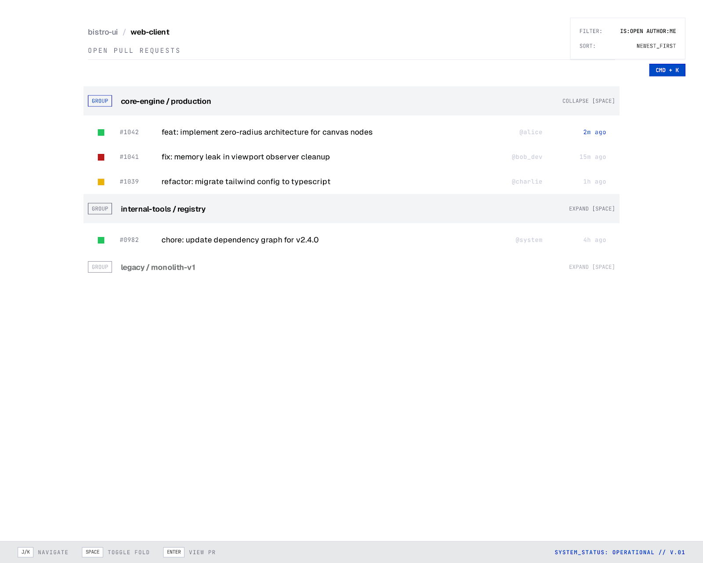
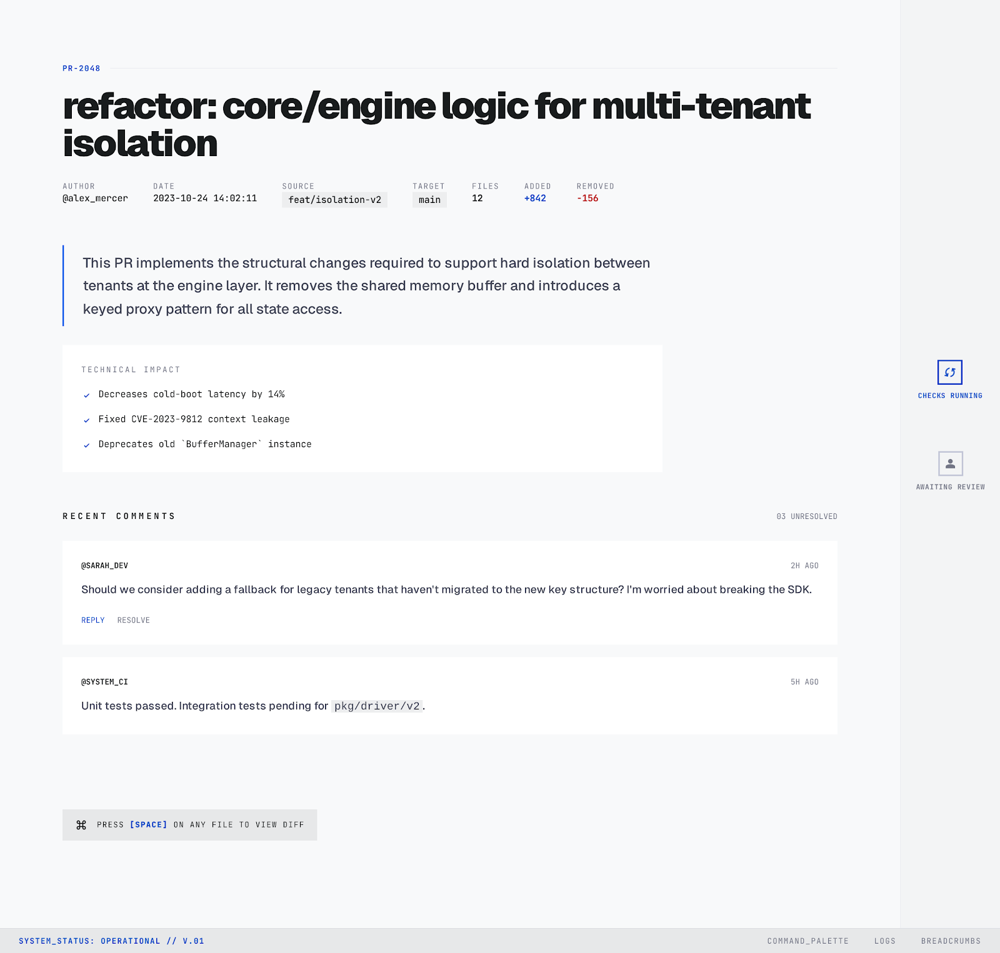

# Bistro

**Keyboard-first, local-first GitHub pull request review.**

Bistro is a desktop app that syncs GitHub pull requests into a local inbox,
generates diffs on your machine, and keeps common review actions on the
keyboard. It is built for reviewers who need to move through many PRs without
living in browser tabs.



## Why Bistro?

Code review didn't get slower — pull requests got faster. AI tools open more
PRs, push more force-updates, and leave more bot comments than the web UI was
designed for. Bistro is built for the reviewer drowning in that stream:

- **Triage first.** Your inbox separates *Needs Action*, *Waiting on Author*,
  and *FYI*, computed locally from who actually requested your review.
- **Runs on your machine.** One Wails v3 process hosts the Go engine and React
  renderer. A local SQLite cache keeps the UI from waiting on every network call.
- **Keyboard everything.** `j`/`k` to move, `Enter` to open, `a a` to approve,
  `:` for the command palette, `?` for help. Every binding is remappable.
- **Local diffs.** PR commits are cloned and diffed locally with go-git, then
  rendered through a virtualized canvas for large reviews.
- **Works offline.** Replayable review actions queue locally when disconnected
  or rate-limited. Unsubmitted review drafts stay local until submission succeeds.



## Core features

- PR inbox filters, search, and per-repo watch toggles
- Needs Action / Waiting on Author / FYI triage with live lane counters
- Full-screen diffs with file navigation, syntax highlighting, and viewed marks
- Draft line/range comments, thread resolution, and review submission
- Local comment classification, with optional bring-your-own-key AI assistance
- Typed Wails events for live sync, rate-limit, review, and settings updates
- Command palette and help overlay that reflect effective bindings, including remaps

GitHub today; GitLab is next on the [roadmap](docs/ROADMAP.md).

## Install

Alpha release assets target macOS Apple Silicon, Windows amd64, and Linux amd64.
See [docs/ALPHA.md](docs/ALPHA.md) for platform installation, unsigned macOS builds,
checksum verification, updates, and data-reset cautions. Alpha means rough edges;
Bistro is not yet stable v1.0.

## Run from source

You need Go 1.26.1, pnpm, a compatible Node runtime, the pinned Wails CLI, and
platform build dependencies. Full prerequisites and configuration are in
[DEVELOPMENT.md](DEVELOPMENT.md#prerequisites).

```bash
git clone https://github.com/Thourum/Bistro.git
cd Bistro
go install github.com/wailsapp/wails/v3/cmd/wails3@v3.0.0
pnpm install
wails3 task dev
```

Sign-in works out of the box through Bistro's own OAuth app, with code exchange
via get-bistro.com. `GITHUB_CLIENT_ID` overrides the embedded client ID. Setting
both `GITHUB_CLIENT_ID` and `GITHUB_CLIENT_SECRET` in the environment exchanges
codes directly with GitHub for your own OAuth app.
The GitHub token lives in the OS keychain. Press `?` anytime to see the available
keyboard actions.

## Keyboard shortcuts

Default bindings are documented on the docs site
([website/src/pages/docs/keybindings.mdx](website/src/pages/docs/keybindings.mdx)).
Inside the app, press `?` for context-aware help or `:` for the command palette.
Navigation styles and overrides are stored in local `settings.json`; edit them
in Settings → Keyboard.

## For developers

The layout is a root Go module (`main.go`, `internal/engine`, `internal/services`,
`internal/shell`), a React renderer in `frontend/`, committed generated bindings
in `frontend/bindings/`, and a separate documentation site in `website/`.

Architecture, builds, and debugging live in [DEVELOPMENT.md](DEVELOPMENT.md).
[CLAUDE.md](CLAUDE.md) is the canonical conventions/verification guide.
Contribution requirements, including DCO sign-off, live in
[CONTRIBUTING.md](CONTRIBUTING.md), with onboarding in
[design/contribution-guide.md](design/contribution-guide.md).

## Privacy and feedback

Bistro stores PR data in a local SQLite cache, tokens in the OS keychain, and
generates diffs locally. Sync and review actions talk directly to GitHub. OAuth
code exchange may use Bistro's relay; BYOK classification and telemetry are
optional outbound integrations. See the
[privacy explainer](website/src/pages/docs/privacy.mdx).

Report issues through GitHub issues or discussions. Read the
[feedback guide](website/src/pages/docs/feedback.mdx) before sharing logs or
private repository context.

## Developed by

Built by **Samuel Asvanyi** at **Itterno ApS**.

## License

Bistro is licensed under the [GNU General Public License v3.0 only](LICENSE).

© 2026 Itterno ApS.
